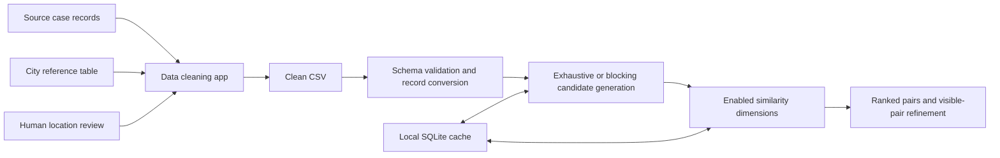

# Missing Persons Data Matching

Two complementary local tools for preparing heterogeneous case records and exploring potential matches: a Streamlit data-cleaning application and an interpretable similarity-based matching application. A clean CSV connects the two tools, so their workflows remain independent while sharing one research project and installation.

## Research Context

Developed during a PIR (*Projet d'Initiation à la Recherche*) at INSA Lyon, Telecommunications department. The academic work relates to research intended to support the International Committee of the Red Cross (ICRC/CICR) in searching for missing persons. This repository is an academic prototype; it does not claim an officially deployed ICRC system or institutional endorsement.

## The Problem

Different records may describe the same person with inconsistent spelling, name order, location labels, dates or missing fields. These variations complicate data preparation and candidate retrieval. A potential correspondence requires human investigation; a similarity score cannot establish identity.

## Project Objectives

- Map heterogeneous CSV/XLS/XLSX columns to a common schema while retaining source values.
- Normalize names and dates, resolve locations against a supplied reference table, and support human review of uncertain locations.
- Rank candidate record pairs using explicit name, phonetic, geographic and temporal criteria.
- Expose score components, blocking rules and analysis refinement history for inspection.
- Demonstrate the full workflow with newly fabricated records, without distributing a real case database.

## Data Cleaning

The application supports manual column mapping and repeated first-/last-name columns. It removes accents, normalizes case/punctuation and whitespace, builds name tokens, and parses dates into ISO format. The original values remain available in the exported CSV.

Location resolution first tries exact normalized city/department matches. Ambiguous, mismatched or approximate matches remain candidates for human validation. Approximate scores use RapidFuzz character/token comparisons and explicit abbreviation/containment rules. Department information contributes to ranking, and an optional country field limits the search. Coordinates come only from the user-supplied reference table; there is no online geocoding or inferred location.

The interface supports candidate acceptance, manual reference selection, marking a location empty, and applying a decision to records with the same location inputs. Quality summaries report verified locations, coordinates, dates and unresolved cases. Both CSV and Excel readers preserve text identifiers such as `0001`.

## Identity Matching

Implemented dimensions:

| Dimension | Method |
| --- | --- |
| Written names | A custom Jaro–Winkler implementation, squared before aggregation. Available subscores combine direct structured names (or full-name fallback), sorted tokens and greedy token alignment with unmatched-token penalties. Weights are 0.40, 0.45 and 0.15. |
| Phonetics | Optional Epitran transliteration, sorting tokens by IPA, and PanPhon feature edit distance. The normalized similarity is raised to power 2.5. Language defaults to `spa-Latn`. |
| Geography | Haversine distance, score 1 below the minimum distance and 0 above the maximum, with linear interpolation between them. |
| Time | Absolute date difference; score `max(0, 1 - days / maximum_days)`. |

The final score is the weighted mean of enabled, calculable dimensions:

`S = sum(w_i * s_i) / sum(w_i)`

Unavailable dimensions are excluded rather than replaced by zero. If no dimension is calculable, no final score is produced. These are heuristic scores, not calibrated probabilities or a trained machine-learning model.

Two search scopes are implemented: global pair matching and matching one selected case. Exhaustive mode compares all eligible pairs; standard blocking retains pairs satisfying at least one rule:

- **R1:** compatible bags of name initials and dates within a configured interval.
- **R2:** compatible first-sound buckets and dates within that interval. These buckets are inexpensive spelling rules, distinct from the full IPA similarity calculation.
- **R3:** geographic and temporal distances below configured thresholds.

Indexed buckets reduce candidate generation. Results are filtered by minimum score, sorted and limited. Refinement rescoring applies to previously displayed pairs only, with back/forward analysis history. Custom blocking remains an unimplemented placeholder.

SQLite stores IPA values, blocking buckets and selectively reusable pair components. Pair components are retained when at least two component scores exceed 0.5; final scores are rebuilt for the current thresholds. Cache contents may contain identifying information when real records are used and are excluded from Git. CPU-heavy scoring supports a process pool using the `spawn` context.

## Architecture



```text
data_cleaning/           Preparation application and pure processing modules
identity_matching/       Matching application, engine, scoring, UI and cache code
examples/                Fabricated input tables, clean CSV and end-to-end demo
docs/                    Methods, migration, publication review and historical notes
tests/                   Original suites plus integration, IO, SQLite and UI checks
.streamlit/config.toml   Preserved local interface theme
pyproject.toml           Package metadata and dependency declarations
requirements*.txt        Resolved dependencies and development tools
```

There is one Git repository with both original histories connected by a merge commit. The code is kept in separate Python packages rather than combined into one artificial application.

## Technologies

Python, pandas, Streamlit, RapidFuzz, python-dateutil, openpyxl, xlrd and SQLite; optional Epitran/PanPhon. Pytest tests the processing and applications; Ruff formats Python and checks imports/code errors. No external AI service or API key is required.

## Installation & Usage

Python 3.12 is recommended for the complete phonetic workflow. Core preparation/matching was also checked on Fedora's Python 3.14. The resolved files target Python 3.12; installing phonetic dependencies on Python 3.14 failed in this environment because `editdistance` needed unavailable Python development headers.

From the repository directory, using an installed Python 3.12:

```bash
python3.12 -m venv .venv
source .venv/bin/activate
python -m pip install -r requirements-phonetic.txt
python -m pip install --no-deps -e .
```

For the core application without the optional phonetic libraries, install `requirements.txt` instead. The already prepared local environment, when provided with this migration, can be activated directly with `source .venv/bin/activate`.

Launch the tools in separate terminals from the repository root:

```bash
python -m streamlit run data_cleaning/app.py --server.address 127.0.0.1 --server.port 8501
python -m streamlit run identity_matching/app.py --server.address 127.0.0.1 --server.port 8502
```

The first tool takes a persons table and a city reference table. The second takes the exported clean CSV. Start with [`examples/`](examples/README.md). No API credentials or real dataset are included. `MATCHING_CACHE_DIR` optionally selects a private cache directory; `.env.example` documents the shell setting and is not automatically loaded.

The matching schema requires `case_id`, `full_name_raw`, `full_name_normalized`, `name_tokens`, `disappearance_city_verified`, `latitude`, `longitude`, and `disappearance_date_parsed`. Required columns may contain missing values; missing or duplicated case IDs block matching because pair indexing requires unique IDs. First-/last-name and department fields are recommended. The cleaner exports this contract directly.

## Example Workflow

```bash
python -m examples.demo
# Optional, with phonetic dependencies installed:
python -m examples.demo --phonetic
```

The demo reads four invented case records and two invented locations, demonstrates an explicit human correction, writes `generated/synthetic_clean.csv`, reloads it through the actual matching loader, and compares all six pairs. Its output illustrates mechanics only; it is not an evaluation of identification accuracy. A reviewed clean fixture is also available at `examples/synthetic_clean.csv` for direct UI upload.

## Verification

```bash
python -m pip install -r requirements-dev.txt
python -m pytest -q
ruff check .
ruff format --check .
```

Tests cover original cleaning/matching behavior, blocking indexes, cache reuse, sequential/parallel agreement, refinement history, actual CSV/XLSX interchange, identifier preservation, token interoperability, SQLite rollback/closure and both Streamlit startup screens. Mocked phonetic unit tests are supplemented by a real-library synthetic smoke test documented in `docs/VERIFICATION.md`.

## Limitations

- No labeled real-world evaluation, accuracy/recall benchmark, or operational validation is provided.
- Similar names and places can produce false positives. Missing fields, language assumptions and blocking can produce false negatives; blocking requires dates and may discard otherwise relevant records.
- Exhaustive comparison is quadratic. Broad buckets and cache tables can still grow substantially; no production-scale benchmark is claimed.
- Name normalization and greedy token alignment lose information. Date parsing includes heuristic/fuzzy fallbacks and assumes day-first input except ISO dates.
- Fewer calculable dimensions can inflate apparent confidence. A high score always needs contextual human review.
- Phonetic resources and language models may be unavailable; the interface reports this and excludes unavailable scores.
- Streamlit is a local research interface without authentication, access-control or an operational deployment design. Startup and processing were verified; every interactive browser action was not exercised.
- This repository retains legacy history. **Publication is pending provenance and rights review** described in [`docs/PUBLICATION_REVIEW.md`](docs/PUBLICATION_REVIEW.md).

## Research Context & Acknowledgements

The original work was carried out at INSA Lyon within the PIR context described above. Original authorship is retained in Git. Reference to the ICRC explains the research context and does not imply endorsement, deployment or publication permission. No confidential ICRC document or real case database has been added during this migration. A license will only be selected after publication rights are confirmed.
